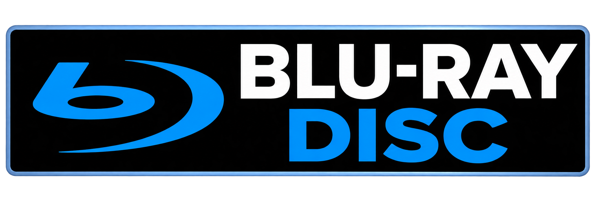
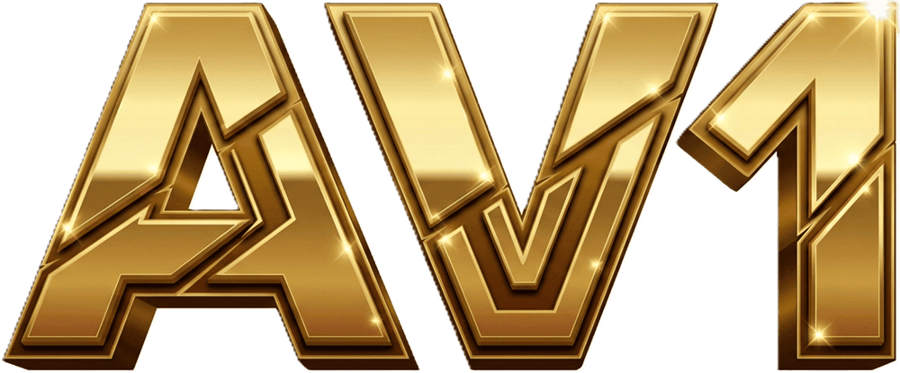
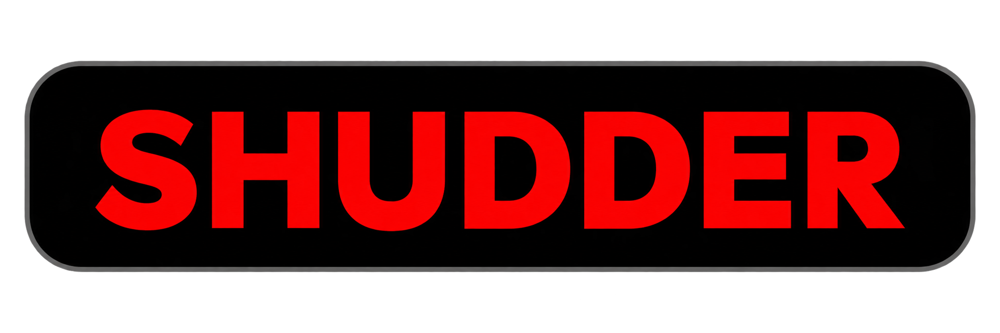
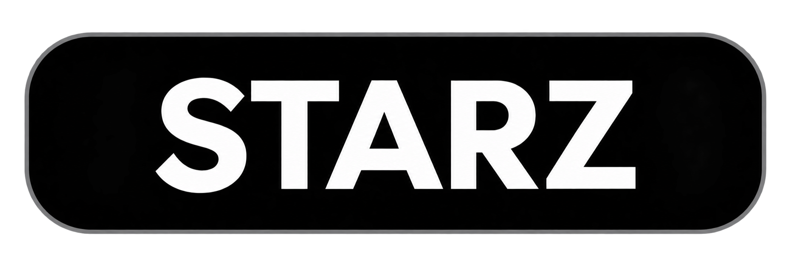
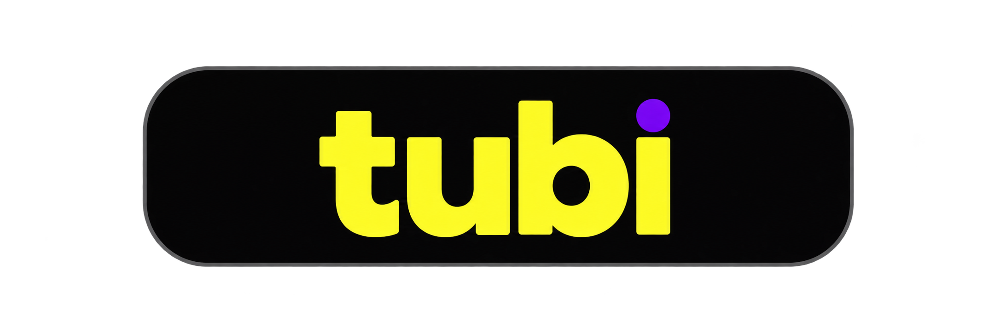
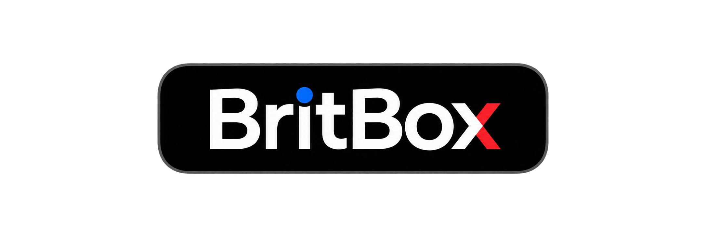
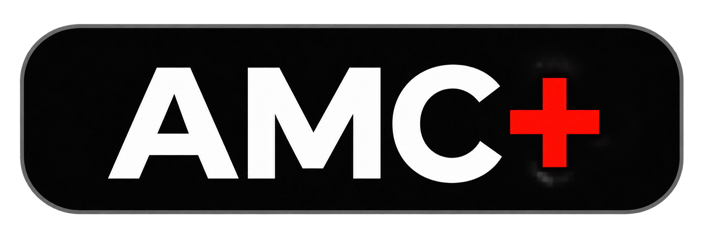
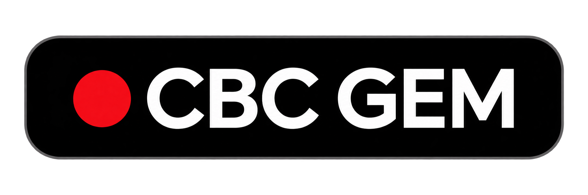
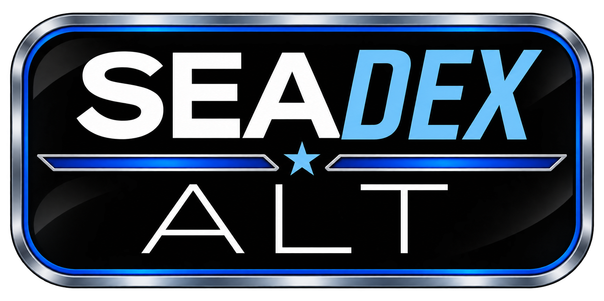

# BullSupreme Nuvio Elite Plus

An Elite-style Fusion badge pack with clearer logos, language flags, streaming services and anime markers.

## Install

Import this URL in Nuvio Fusion badge settings:

```text
https://raw.githubusercontent.com/BullSupreme/BullSupreme-Nuvio-Elite-Plus/main/elite-language-streaming-badges.json
```

Badges appear only when the stream title or description contains the information needed by the matching rule. Language flags represent language labels, not a guarantee of a particular audio track or subtitle.

## Badge gallery

The gallery shows every badge included in the pack.

### Source

| Badge | Meaning |
| :--- | :--- |
|  | REMUX |
|  | Blu-ray Disc |
|  | WEB-DL |
|  | WEBRip |
|  | HDTV |
|  | DVD RIP |

### Resolution

| Badge | Meaning |
| :--- | :--- |
|  | 4K Ultra HD |
|  | 1080p Full HD |
|  | 720p HD |
|  | 480p SD |

### Video Tech

| Badge | Meaning |
| :--- | :--- |
|  | Dolby Vision |
|  | HDR10+ |
|  | HDR10 |
|  | HDR |
|  | SDR |
|  | IMAX Enhanced |
|  | IMAX |

### Video Codec

| Badge | Meaning |
| :--- | :--- |
|  | HEVC |
|  | AVC |
|  | AV1 |
|  | VP9 |

### Bit Depth

| Badge | Meaning |
| :--- | :--- |
|  | 10Bit |
|  | 8Bit |
|  | 12-BIT |

### Audio Tech

| Badge | Meaning |
| :--- | :--- |
|  | Dolby Atmos |
|  | TrueHD |
|  | Dolby Digital Plus |
|  | Dolby Digital |
|  | DTS:X |
|  | DTS-HD Master Audio |
|  | DTS-HD |
|  | DTS |

### Audio Channels

| Badge | Meaning |
| :--- | :--- |
|  | 7.1 Audio |
|  | 5.1 Audio |

### Language

| Badge | Meaning |
| :--- | :--- |
|  | German |
|  | English |
|  | Spanish |
|  | French |
|  | Hindi |
|  | Italian |
|  | Japanese |
|  | Korean |
|  | Latino |
|  | Portuguese |
|  | Russian |
|  | Chinese |

### Streaming

| Badge | Meaning |
| :--- | :--- |
|  | Netflix |
|  | Prime Video |
|  | Apple TV+ |
|  | Disney+ |
|  | Max |
|  | Hulu |
|  | Peacock |
|  | Paramount+ |
|  | Crave |
|  | Crunchyroll |

|  | Shudder |
|  | STARZ |
|  | Tubi |
|  | BritBox |
|  | AMC+ |
|  | CBC Gem |

### Anime

| Badge | Meaning |
| :--- | :--- |
|  | SeaDex Best |
|  | SeaDex Alternative |

## Credits

Original Elite artwork: [Elite Badges by leonevz](https://github.com/leonevz/Elite-Badges). Language flags, streaming logos and AV1 artwork: [djgenesis/stream](https://github.com/djgenesis/stream). The enhanced and additional artwork was created for this pack.
